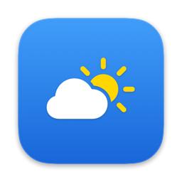
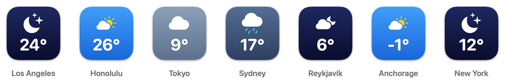
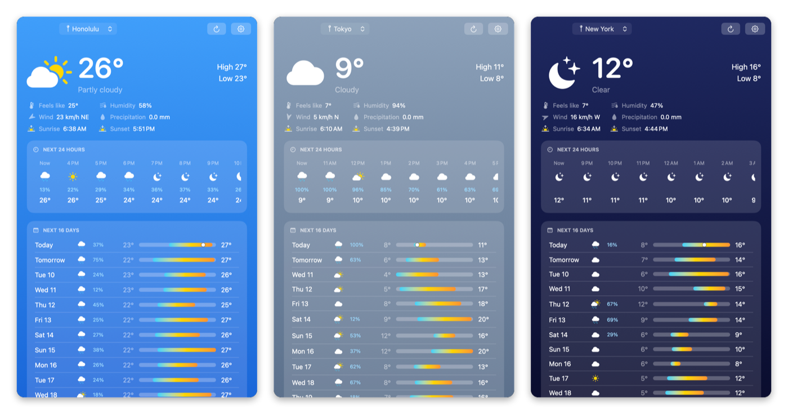

<div align="center">



# TiempoDock

**Live weather in your Mac's Dock icon.**<br>
Free, open source, no ads, no account.

[](https://github.com/davidcasanovasola-git/TiempoDock/releases/latest)


[](LICENSE)



</div>

## Install

Open **Terminal** and paste:

```bash
curl -fsSL https://raw.githubusercontent.com/davidcasanovasola-git/TiempoDock/main/scripts/get.sh | bash
```

That's it. It downloads the latest release, checks it hasn't been tampered with, moves it to Applications and opens it. From then on it updates itself.

## Features

- 🌤️ **Live Dock icon:** sky-aware background with temperature, feels-like, wind, humidity, today's or tomorrow's high/low, or chance of rain.
- 🖱️ **Right-click the icon** for the current weather, the next hours and the next days.
- 📅 **Click the icon** for the full forecast: 24 hours and up to 16 days.
- 📍 **Multiple locations:** your current location or any city in the world.
- 🔄 **Updates itself** from GitHub Releases, with a verified origin.
- 🚀 **Opens at login** quietly, with just the Dock icon and no window.
- 🌡️ **Your units:** °C or °F; km/h, m/s, mph or knots; mm or inches; 12- or 24-hour clock. The defaults follow your Mac's region.
- 📌 Optional temperature in the menu bar.
- 🌍 **Speaks your language:** English, Español, Català, Français, Deutsch and Português, picked automatically from your system.

<p align="center"></p>

Weather data comes from [Open-Meteo](https://open-meteo.com), which is free and needs no API key.

## Tips

- **Start at login:** Settings › General › *Open TiempoDock at login*.
- **Keep it in the Dock:** right-click the icon › Options › Keep in Dock.
- **No location services?** Add your city in Settings › *Locations*.
- **Different language for this app only:** System Settings › General › Language & Region › Applications.

<details>
<summary><b>Downloaded the zip from your browser and macOS blocks it?</b></summary>

<br>

TiempoDock isn't signed with a paid Apple certificate, so macOS blocks it the first time when it comes from a browser. The installer command above avoids this. If you already downloaded the zip, do either of these:

- Move the app to Applications, try to open it, then go to **System Settings › Privacy & Security › Open Anyway**.
- Or run:
  ```bash
  xattr -dr com.apple.quarantine /Applications/TiempoDock.app
  ```

</details>

<details>
<summary><b>How are updates verified?</b></summary>

<br>

Every 6 hours the app checks the [latest release](https://github.com/davidcasanovasola-git/TiempoDock/releases/latest). Before installing it checks three things:

1. The SHA-256 of `TiempoDock.zip` matches the published `TiempoDock.zip.sha256`.
2. GitHub has a signed [build provenance attestation](https://docs.github.com/actions/security-for-github-actions/using-artifact-attestations) for that exact file. This proves it was built by this repository's release workflow from its source code.
3. The app inside has the right bundle identifier and a valid code signature.

If any of these fails, nothing is installed. You can check a download yourself:

```bash
gh attestation verify TiempoDock.zip --repo davidcasanovasola-git/TiempoDock
```

You can turn automatic updates off in Settings › General.

</details>

<details>
<summary><b>Build from source</b></summary>

<br>

You need the Xcode Command Line Tools (`xcode-select --install`). Full Xcode isn't needed.

```bash
git clone https://github.com/davidcasanovasola-git/TiempoDock.git
cd TiempoDock
./scripts/install.sh     # build, copy to /Applications and open
./scripts/build.sh       # build only → build/TiempoDock.app (universal)
```

</details>

<details>
<summary><b>Publishing a release (maintainers)</b></summary>

<br>

```bash
./scripts/release.sh 1.2.0
```

This pushes the tag `v1.2.0`. The [release workflow](.github/workflows/release.yml) then builds the universal app, generates the checksum and the provenance attestation, and publishes the release. Installed apps pick it up automatically.

</details>

<details>
<summary><b>Project structure</b></summary>

<br>

| Path | Purpose |
| --- | --- |
| `Sources/TiempoDock/DockIcon.swift` | Draws the Dock icon |
| `Sources/TiempoDock/WeatherStore.swift` | Locations, forecasts, refresh timer |
| `Sources/TiempoDock/WeatherService.swift` | Open-Meteo client (forecast + city search) |
| `Sources/TiempoDock/ForecastView.swift` | Forecast window |
| `Sources/TiempoDock/SettingsView.swift` | Settings |
| `Sources/TiempoDock/Menus.swift` | Dock menu, menu bar and main menu |
| `Sources/TiempoDock/Updater.swift` | Self-updates from GitHub Releases |
| `Sources/TiempoDock/LoginItem.swift` | Start at login (no window) |
| `scripts/` | Build, install, one-line installer and release |

</details>

<details>
<summary><b>Translating TiempoDock</b></summary>

<br>

The app's texts live in [`Resources/Localization/<language>.lproj/Localizable.strings`](Resources/Localization). The keys are the English texts.

To add a language, copy `es.lproj` to a new folder, for example `it.lproj`, translate the values on the right and open a pull request. The build picks up every `.lproj` folder automatically.

</details>

<details>
<summary><b>Known limitations</b></summary>

<br>

- When the app is closed, the Dock shows the plain icon. The weather is only drawn while it runs.
- Because the app uses a local (ad-hoc) signature, macOS may ask for location permission again after an update.

</details>

## License

[MIT](LICENSE). Weather data by [Open-Meteo.com](https://open-meteo.com) ([CC BY 4.0](https://creativecommons.org/licenses/by/4.0/)).
